# FAQ: How do I use external sidechain in my DAW?

This article explains how to use an external sidechain signal with **UAD Native plug-ins** in various DAWs. The following UAD Native plug-ins support external sidechain input:

- **API 2500 Bus Compressor**
- **API Vision Channel Strip**
- **Capitol Mastering Compressor**
- **SSL 4000 E Channel Strip Collection**
- **SSL 4000 G Bus Compressor**

For a detailed explanation of how to use sidechaining with UAD Native plug-ins, see the plug-ins manual page <a href="17949313152532-Using-an-External-Sidechain-with-UAD-Plug-Ins.html" rel="noopener noreferrer" target="_blank">here</a>. 

## Configuring a Sidechain in Your DAW

Each DAW handles external sidechaining differently. Click on the preferred DAW below to access its specific steps:

- <a href="#h_01H8CKV23581N126GH2G92CCSV" target="_self">Logic Pro</a>
- <a href="#h_01H8CKTJ20YDDMY2F2F54JG0V9" target="_self">Ableton Live</a>
- [Cubase and Nuendo](#h_01H8CKTWC2EGCWH8ZERCTMVE7R)
- <a href="#h_01H8CKV769RESWJRBGJD7BFP5P" target="_self">Pro Tools</a>

## Logic Pro

**Note:** the steps for Logic Pro are also available in <a href="https://www.youtube.com/watch?v=yaMrPR3AH2A" rel="noopener noreferrer" target="_blank">this video</a>.

1.  Load a native plug-in that can be sidechained.\
    In this example, we are loading the **Capitol Mastering Compressor** on our **Synth Bass** track.\
    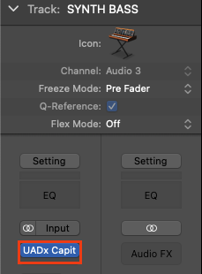
2.  Open the plug-in window and click the **Sidechain** slider button to enable the functionality.\
    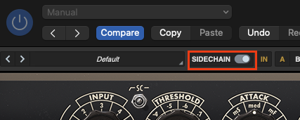
3.  In the upper header of the plug-in, click the **Side Chain drop-down menu** and select the track you want to use as a sidechain source. In this example, we are sidechaining our **Synth Bass** track to the **Drums** audio track in our project.\
    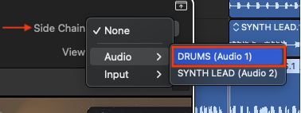

## Ableton Live

**Note: T**he steps for Ableton Live are also available in <a href="https://www.youtube.com/watch?v=Emyt-hEDllw" rel="noopener noreferrer" target="_blank">this video</a>.

1.  Load a UAD Native plug-in that can be sidechained. In this example, we are loading the **API 2500 Bus Compressor** VST3 plug-in on a track labeled **Synth Bass**. We also have another track, labeled **Drums**, that we will use as our sidechain source in the next step.
2.  In the plug-in tab located in the **Device View Selector** at the bottom, select a **Sidechain** source.\
    In this example, we are choosing our **Drums** track.\
    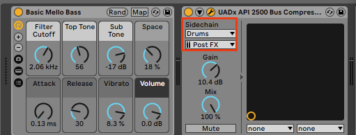
3.  In the upper header of the plug-in window, the **Sidechain** switch will enable automatically\*, as shown below. You can disable it to easily A/B the resulting sound, if necessary, without changing sidechain settings.\
    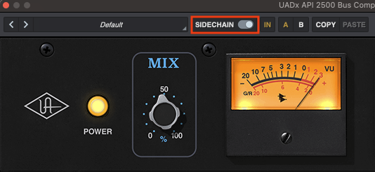

**Important:** The sidechain switch toggles automatically with the VST3 plug-in, but not the Audio Units version. When using the Audio Units version you will need to toggle the sidechain switch to enable.

## Cubase and Nuendo

**Note:** the steps for Cubase and Nuendo are also available in <a href="https://www.youtube.com/watch?v=r-wjJSZOshM" rel="noopener noreferrer" target="_blank">this video</a>.

1.  Insert a UAD Native plug-in that can be sidechained onto the desired channel.\
    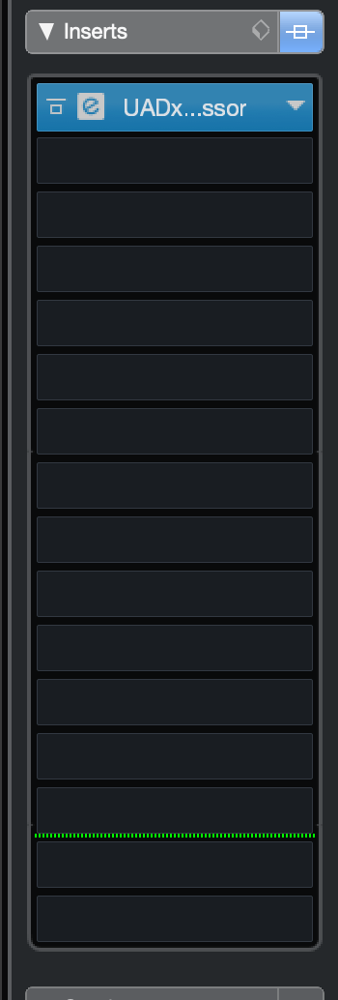

2.  Open the plug-in window and enable sidechaining within Cubase or Nuendo.\
    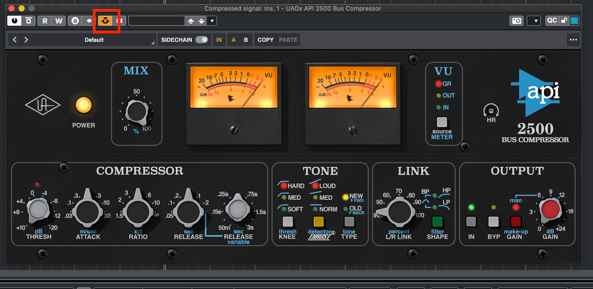

3.  Hit the settings cog to the right of the enable sidechain button. Select “Add Side-Chain Source” and select the desired track.

    **Note: T**he track name in this example is “Sidechain source.”

    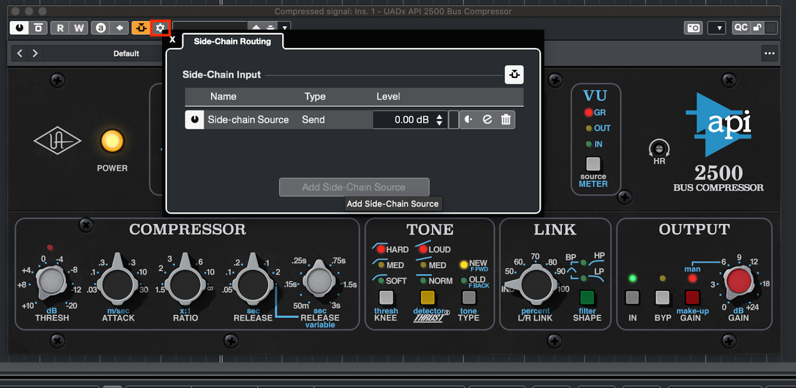

4.  Enable the sidechain input on the plug-in.\
    

## Pro Tools

**Note: T**he steps for Pro Tools are also available in <a href="https://www.youtube.com/watch?v=x8naU2OZxnc" rel="noopener noreferrer" target="_blank">this video</a>.

1.  Insert the UAD Native plug-in onto the desired channel.\
    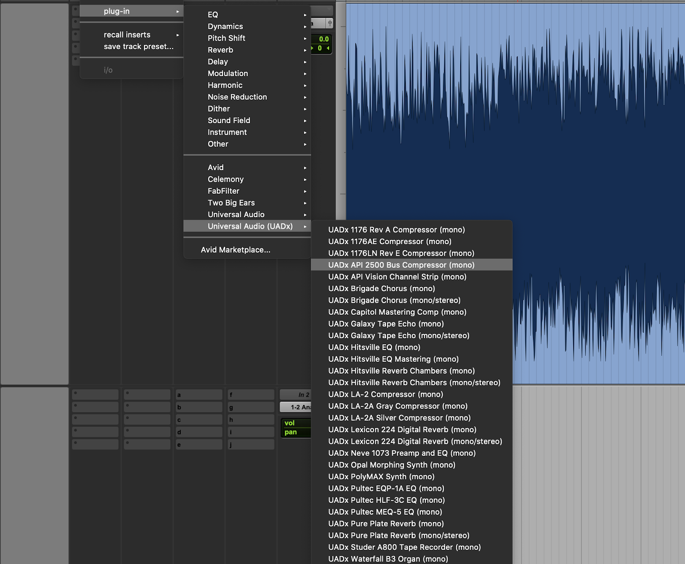

2.  Open the plug-in window and select the desired bus to enable side-chaining within Pro Tools.\
    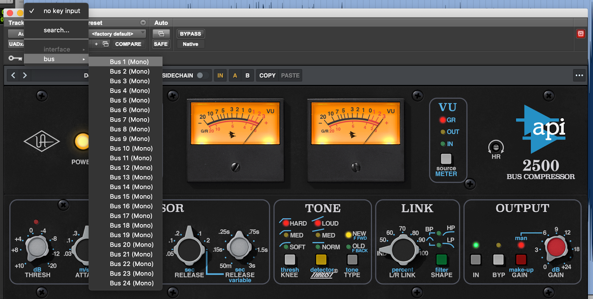

3.  On the track that feeds the side-chain input, create a send to the previously selected bus. In this case, Bus 1 will be used.\
    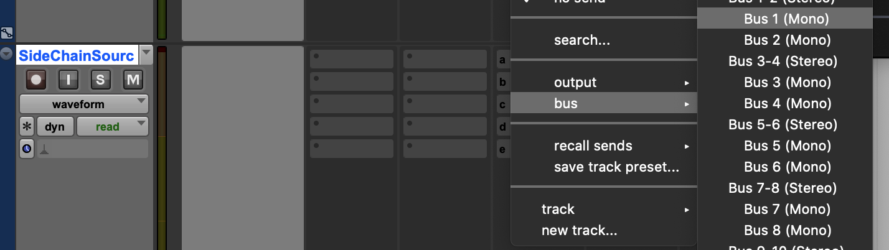

4.  Turn up the send to a desired level.\
    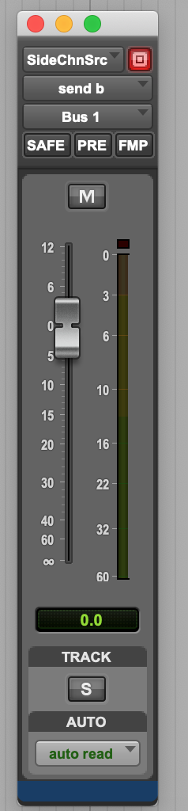

5.  Confirm side-chaining is enabled in the plug-in.\
    

    **Note:** Pro Tools should automatically enable side-chaining in the plug-in once the side-chain input has been selected.\
     

