# UA Connect with UAFX Pedals

UA Connect and UAFX Control are the companion software apps for UAFX pedals. [Download UA Connect and UAFX Control here](https://www.uaudio.com/pages/download-uafx-pedals). 

**UA Connect –** Use the UA Connect app to get your free bonus effects, speaker cabinets, custom voicings, and pedal firmware updates. UA Connect is available for desktop/laptop computers only. All UA Connect functions with UAFX require a USB connection to a computer, using a USB-C cable (not included).

**UAFX Control –** Use the UAFX Control app to get your free bonus effects, speaker cabinets, and custom voicings. UAFX Control is also (unlike UA Connect) for preset management, deep editing, MIDI PC and CC assignments, and global settings such as footswitch modes. UAFX Control is available for mobile devices only, and connects to the pedal with Bluetooth or USB. For the UAFX Control Manual, [go here](360058187832-UAFX-Control-Manual.html).

## This article includes:

- <a href="#h_01GX6WFH3ZRJT2F3WSAV047P54" target="_self">Installing UA Connect</a>
- <a href="#h_01GX6WG4R963JABXSKH4YZ0RNJ" target="_self">Registering your UAFX pedal with UA Connect</a>
- <a href="#h_01GX6WGH5N0S4B4WXZ84MGQQ75" rel="undefined" target="_self">Selecting Bonus Effects and Speaker Cabinets</a>
- <a href="#h_01GX6WH5QNA79WAJ44YCSS221Y" target="_self">Updating Your UAFX Pedal</a>

------------------------------------------------------------------------

# Installing UA Connect

See <a href="13178401374612-Getting-Started-with-UA-Connect.html" target="_self">Getting Started with UA Connect</a> for system requirements and installation information.

------------------------------------------------------------------------

# Registering your UAFX pedal with UA Connect

To register ownership of your pedal use UA Connect or the UAFX Control app.

When a UAFX pedal is registered, any bonus effect(s) or speaker cabinets, and (if applicable) presets and custom voicings are added to your pedal. If the pedal is subsequently registered by a different user, registration is transferred automatically.

**Important:** Only connect one UAFX pedal to your computer and UA Connect at a time. UA Connect does not support multiple connected UAFX pedals. 

#### To register your pedal:

1.  After installing the application, launch UA Connect.
2.  Log in with your uaudio.com account login and password, or click Create Account to create a uaudio.com account.\
    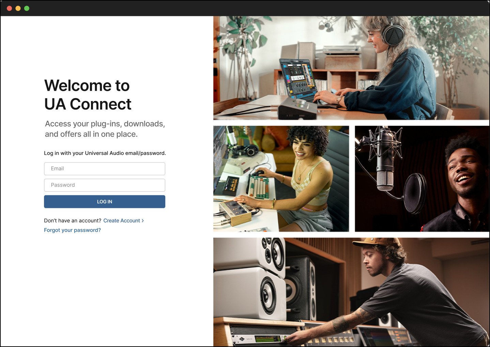\
     
3.  Connect a UAFX pedal to your computer with a USB-C cable (not included). The USB-C port can be connected to any type of USB port on your computer, but you may need an adapter. Make sure the pedal is also connected to 9VDC power (400 mA minimum). \
    **Connect only one UAFX pedal to the computer.**
4.  Click the UAFX Pedals tab on the left side of the UA Connect screen. UA Connect prompts you to register your pedal.\
    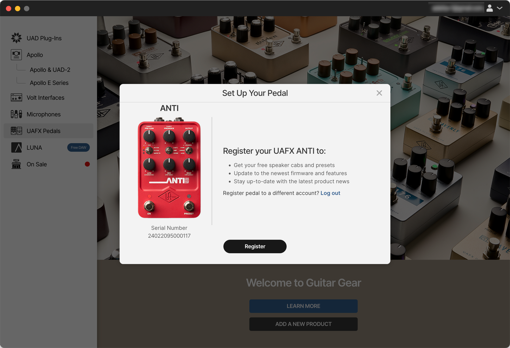\
     
5.  Click the Register Pedal button to register your pedal.\
    After the pedal is registered, you can disconnect the USB-C cable.

**Note:** You should disconnect the USB-C port from your computer before playing through the pedal, as the USB connection may generate noise when connected to the computer.

------------------------------------------------------------------------

# Selecting Bonus Effects and Speaker Cabinets

After pedal registration, the bonus effects and speaker cabinets are available for use. The bonus effects and speaker cabinets are selected with the Effect Type or Speaker switch and indicated with a green LED (the bonus effects and speaker cabinets don't have labels).

## ANTI 1992 bonus speaker cabinets

After registration, the D65, Super 80, and Brown JB speaker cabinets are added to the pedal. To select these speaker cabinets, push the Effect Type switch until the top, middle, or bottom LED is lit green.

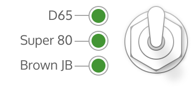

## Astra bonus effects

After registration the Phaser X90 and Dharma Trem 61 effects are added to the pedal. To select these effects, push the Effect Type switch until the top or middle LED is lit green.

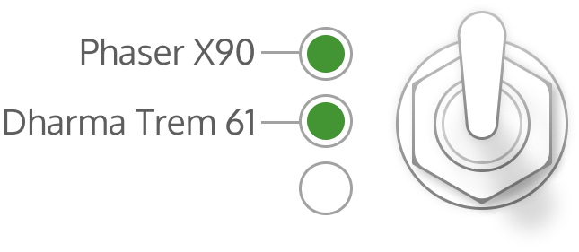

## Dream '65 bonus speaker cabinets

After registration, the Boutique D65, S-Verb, and JBF120 speaker cabinets are added to the pedal. To select these speaker cabinets, push the Effect Type switch until the top, middle, or bottom LED is lit green.

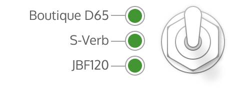

## Enigmatic '82 bonus speaker cabinets

After registration, the 4x12 UK V30, 2x12 JBF120, 1x12 Black EV12, 4x12 Stripped GB, 1x12 JBG125, and 2x12 D-EV12 speaker cabinets are added to the pedal. To select these speaker cabinets, push the Effect Type switch until the top, middle, or bottom LED is lit green or amber.

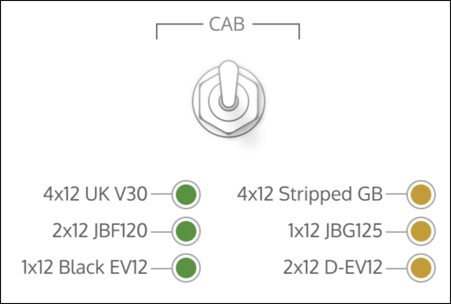

## Golden bonus effect

After registration, the Chamber & Plate 224 reverb is added to the pedal. To select this effect, push the Effect Type switch until the top LED is lit green.

<figure class="wysiwyg-image wysiwyg-image-resized" style="width: 39.7%;">
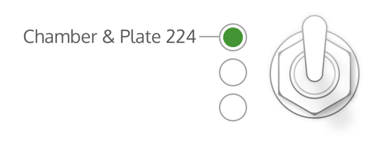
</figure>

## Knuckles '92 bonus speaker cabinets

After registration, the D65, Super 80, and Brown JB speaker cabinets are added to the pedal. To select these speaker cabinets, push the Effect Type switch until the top, middle, or bottom LED is lit green.

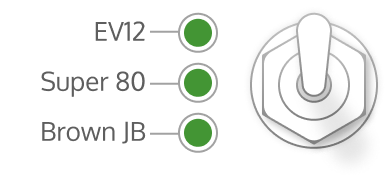

## Lion '68 bonus speaker cabinets

After registration, the EV12, D65, and V30 speaker cabinets are added to the pedal. To select these speaker cabinets, push the Effect Type switch until the top, middle, or bottom LED is lit green.

<figure class="wysiwyg-image wysiwyg-image-resized" style="width: 58.29%;">

</figure>

## Ruby '63 bonus speaker cabinets

After registration, the Blue Mod, Match, and Gold speaker cabinets are added to the pedal. To select these speaker cabinets, push the Effect Type switch until the top, middle, or bottom LED is lit green.

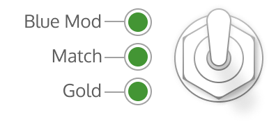

## Starlight bonus effect

After registration, the Cooper Time Cube delay is added to the pedal. To select this effect, push the Effect Type switch until the top LED is lit green.

<figure class="wysiwyg-image wysiwyg-image-resized" style="width: 35.64%;">
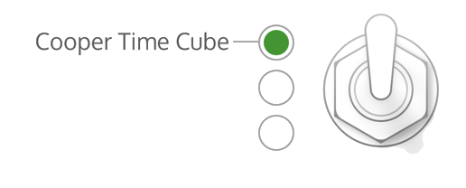
</figure>

## Woodrow '55 bonus speaker cabinets

After registration, the Vee30, B-Man, and JB120 speaker cabinets are added to the pedal. To select these speaker cabinets, push the Effect Type switch until the top, middle, or bottom LED is lit green.

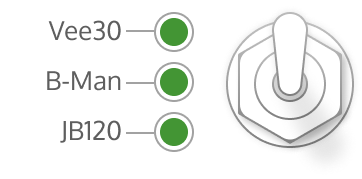

------------------------------------------------------------------------

# Updating Your UAFX Pedal

UAFX pedal updates are installed with the UA Connect app ([get it here](https://www.uaudio.com/pages/download-ua-connect)). Firmware updates for UAFX may be provided to improve or add functionality, and are installed over a USB connection to a computer, using a USB-C cable (not included).

Your pedal's presets are retained when you update the firmware.

Connect the pedal's USB-C port to your computer and start UA Connect to check for available updates. Make sure the pedal is connected to 9VDC power (400 mA minimum).

**Note:** The pedal's USB-C port can be connected to any type of USB port on the computer, but you may need an adapter.

1.  Click on the UAFX Pedals tab in UA Connect. The connected pedal is highlighted with a green dot below the pedal name and serial number.
2.  When an update is available for your pedal, the pedal tile includes an UPDATE banner and the Update button appears in the firmware area.\
    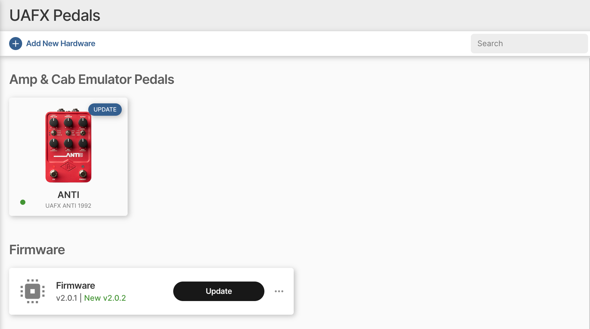\
     
3.  Click the Update button to update your pedal's firmware. Make sure that the pedal remains connected to 9VDC power, and connected via USB to your computer, while the update is in progress.\
    \
    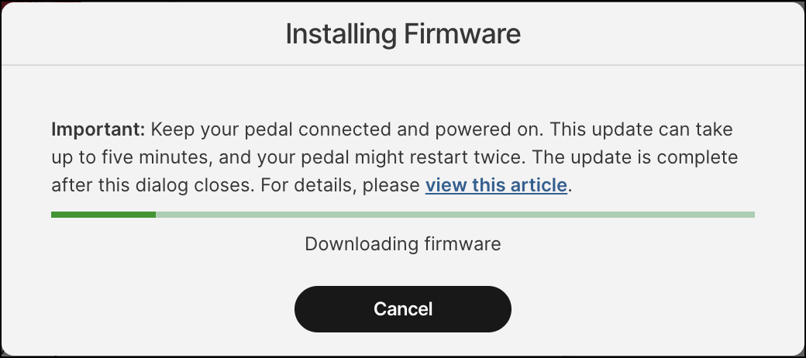\
     
4.  When the update is complete, the pedal restarts. After the pedal restarts, UA Connect shows that the firmware is up to date. After the update is complete, you can disconnect the USB-C port.\
    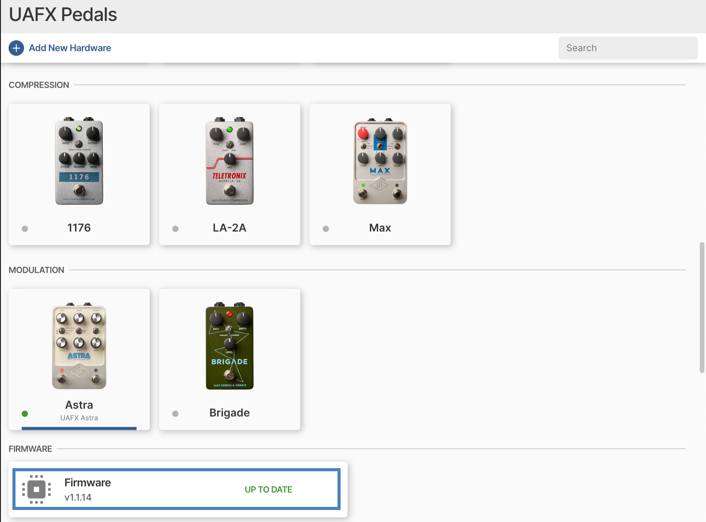

**Note:** You should disconnect the USB-C port before playing through the pedal, as the USB connection may generate noise when connected to the computer.

 

v260129

