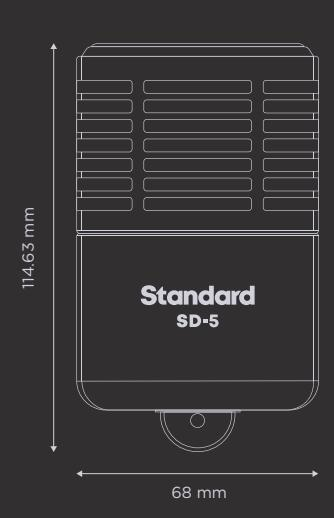

Standard Dynamic Microphone with Mic Modeling

## **Congratulations Get Hemisphere Specifications**

Your new SD-5 Standard Dynamic Microphone with Hemisphere Mic Modeling is designed to deliver years of uncompromising sonic performance.

The SD-5 is a professional dynamic studio microphone suitable for a wide range of audio applications. With its supercardioid polar pattern and extended low frequency response, the SD-5 is perfect for capturing kick drums, bass guitar amps, and other high SPL sources.

Your SD-5 includes Hemisphere mic modeling, giving you a collection of the greatest mics ever made.

Follow these steps to get your Hemisphere Mic Collection plug-in:

- On your computer, visit uaudio.com/mics/hemisphere
- Download, install, and open the UA Connect application. 2
- Click the + Add Hardware button in the app and enter the serial number, which can be found on the package or the XLR connector, then download your plug-in. 3

For complete documentation and support, please visit help.uaudio.com

Type Dynamic

Polar Pattern Supercardioid

Sensitivity -64 dB (0 dB = 1V/Pa @ 1 kHz)

Frequency Range 20 Hz - 15 kHz

Output Impedance 50 Ohms

Output Connector 3-pin XLRM

Used electrical and electronic equipment should not be mixed with general household waste. Please dispose in accordance with local regulations.